<!--
  This is your PROFILE README. It goes in a repo named exactly after your
  username (e.g. github.com/whysaurjya/whysaurjya) so GitHub shows it on your profile.
  Widths 370/490 keep the portrait and info card the same height.
-->

<table>
<tr>
<td valign="top"></td>
<td valign="top"></td>
</tr>
</table>

## Saurjya Acharya

**Visual & UI/UX Designer · Design Strategist · Creative Director**

 

### 🎨 Featured Projects

| Project | Description | Type |
| :--- | :--- | :--- |
| 🏢 **[DIZIVER-V2](https://github.com/whysaurjya/DIZIVER-V2)** | Modern creative studio & digital agency platform — branding, UI/UX design & web. |  |
| 🌿 **[Prakriti](https://github.com/whysaurjya/Prakriti)** | Sustainability-focused digital platform promoting nature awareness & eco-living. |  |
| 🎓 **[Aavaran](https://github.com/whysaurjya/Aavaran)** | All-in-one student productivity platform designed to simplify college life. |  |
| 🪔 **[Aartigo](https://github.com/whysaurjya/Aartigo)** | Premium luxury décor & lighting e-commerce — handcrafted chandeliers & pendants. |  |
| 🚿 **[Neerova](https://github.com/whysaurjya/Neerova)** | Modern plumbing service website connecting homeowners with trusted professionals. |  |

 

<!-- animated contribution graph, refreshed daily by the workflow -->

