<!-- Saurjya Acharya | GitHub Profile README -->
<picture>
  <source media="(prefers-color-scheme: dark)" srcset="./dark.svg">
  <source media="(prefers-color-scheme: light)" srcset="./light.svg">
  
</picture>

<h1 align="center">Hey, I'm Saurjya.</h1>

<strong>UI/UX &amp; Visual Designer · Freelancer</strong>

Designing visuals and strategies that turn ideas into brands.

## About

I'm a freelance UI/UX and Visual Designer with 4 years of experience. I work across digital interfaces, visual systems, and website experiences, bringing together thoughtful design and practical implementation.

- Focus: UI/UX design, visual design, branding, and digital experiences
- Based in: Kolkata, India
- Education: BBA Digital Marketing Hons, Sister Nivedita University

## Selected work

| Project | Focus |
|---|---|
| **PRAHARI** | AI-powered crop-health management platform concept |
| **Neerova** | Plumbing brand website |
| **Kensei** | Premium platform for discovering authentic Japanese katanas |
| **ValorantX** | Valorant website redesign |

## Toolkit

**Design & website tools**  
Figma · Framer · Wix

**Development**  
HTML · CSS · JavaScript · React

## Connect

- **Portfolio:** https://saurjya.in/portfolio
- **GitHub:** https://github.com/whysaurjya
- **LinkedIn:** https://www.linkedin.com/in/whysaurjya/
- **Email:** whysaurjya@gmail.com

---

Thoughtful visuals. Clear experiences. Useful digital products.

