<!--
  This is your PROFILE README. It goes in a repo named exactly after your
  username (e.g. github.com/whysaurjya/whysaurjya) so GitHub shows it on your profile.
  Widths 370/490 keep the portrait and info card the same height.
-->

<table>
<tr>
<td valign="top"></td>
<td valign="top"></td>
</tr>
</table>

## Saurjya Acharya

**Visual & UI/UX Designer · Design Strategist · Creative Director**

 

###  Featured Projects

| Project | Description | Tools |
| :--- | :--- | :--- |
| **[DIZIVER](https://diziver.netlify.app/)** | A modern creative agency platform showcasing branding, digital experiences, UI/UX design, and innovative web development services. |  |
| **[Prakriti](https://prakriiti.netlify.app/)** | An eco-conscious digital platform inspiring environmental awareness, sustainable lifestyles, and meaningful connections with nature. |  |
| **[Aartigo](https://aartigo.netlify.app/)** | A premium e-commerce platform showcasing handcrafted luxury lighting, sculptural décor, and sophisticated interior design collections. |  |
| **[Neerova](https://neerova.netlify.app/)** | A modern plumbing services platform connecting homeowners with reliable professionals through accessible, seamless digital experiences. |  |
| **[DrivoCar](https://drivocar.netlify.app/)** | A smart car rental platform simplifying vehicle discovery, fleet exploration, pricing comparisons, and seamless online reservations. |  |
| **[Akatsukki](https://akatsukki.netlify.app/)** | A creative digital experience inspired by Akatsuki, bringing anime aesthetics, immersive visuals, and interactive storytelling together. |  |
| **[Arogyaam](https://arogyaam.netlify.app)** | A healthcare platform designed to improve patient access, simplify medical services, and enhance digital healthcare experiences. |  |

